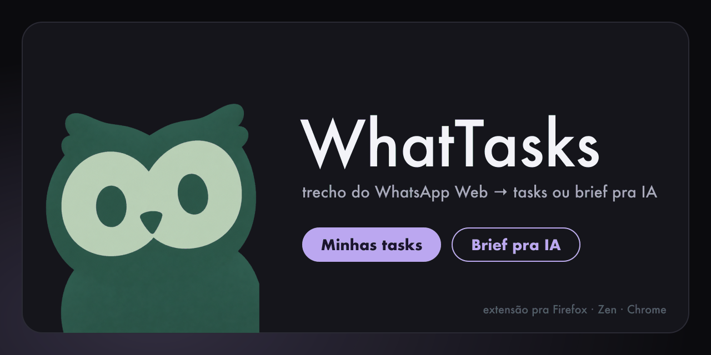
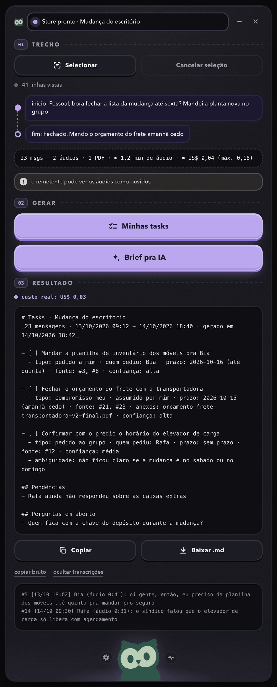
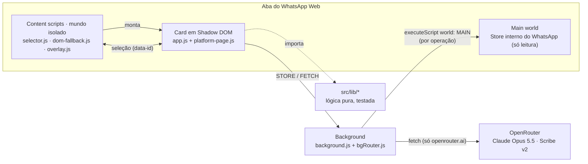

<p align="center">
  
</p>

<h1 align="center">WhatTasks</h1>

<p align="center">
  <strong>Selecione um trecho do WhatsApp Web. Receba o checklist do que pediram pra você, ou um brief pronto pra IA.</strong>
</p>

<p align="center">
  <a href="https://github.com/ArthurMalucelli/whattasks/actions/workflows/ci.yml"></a>
  <a href="https://github.com/ArthurMalucelli/whattasks/releases/latest"></a>
  <a href="LICENSE"></a>
  
  
  
</p>

> **English.** WhatTasks is a Manifest V3 browser extension (Firefox/Zen first, Chrome supported) that adds an owl button to WhatsApp Web's left rail. Click the first and last message of a conversation range and it collects text, voice notes (transcribed), PDFs and images, then asks Claude (via OpenRouter, with your own API key) for either a task checklist of what was asked of you or a structured brief to paste into an AI agent. Read-only, nothing is sent on your behalf, and every run shows its cost upfront. The UI and docs are in Brazilian Portuguese.

---

## O que é

Grupos e conversas longas misturam pedido, áudio de 4 minutos, PDF e "ah, e aquilo pra sexta". O WhatTasks lê só o trecho que você marcar e devolve, em português, **as tasks que caem pra você** (com quem pediu, prazo e de onde veio) ou **um brief pra colar no Claude Code, no ChatGPT ou em outro agente**. Roda dentro do próprio WhatsApp Web, num card flutuante, com a sua chave do OpenRouter.

<p align="center">
  
</p>

### Como usar

| # | Faça | O que acontece |
|---|---|---|
| 1 | Clique na **coruja** no trilho de ícones à esquerda do WhatsApp (abaixo de Conversas, Status, Canais, Comunidades) | Abre o card ao lado do trilho. Na primeira vez, Configurações abre sozinha pra você colar a chave do OpenRouter. |
| 2 | **Selecionar** → clique na **primeira** mensagem → role → clique na **última** | O trecho fica realçado em lilás; o card mostra a contagem (msgs, áudios, PDFs, imagens) e o custo estimado. |
| 3 | **Minhas tasks** ou **Brief pra IA** | Baixa a mídia, transcreve os áudios e manda tudo pro modelo. Acima do teto de custo, acima do limite de áudio ou com áudios no trecho (aviso de recibo ligado), o botão vira **Confirmar ≈ US$ …** e pede um segundo clique em até 10 s. |
| 4 | **Copiar** ou **Baixar .md** | Resultado em Markdown, com o custo real informado pelo OpenRouter. |

<details>
<summary>Exemplo de saída (Minhas tasks, dados fictícios)</summary>

```markdown
# Tasks · Obra Rua das Flores
_38 mensagens · 13/10/2026 09:12 → 14/10/2026 18:40 · gerado em 14/10/2026 18:42_

- [ ] Enviar o orçamento revisado da cozinha ao Pedro
  - tipo: pedido a mim · quem pediu: Pedro · prazo: 2026-10-16 (sexta) · fonte: #4, #11 · anexos: A1 · confiança: alta
- [ ] Confirmar com a Ana se o piso chega antes da pintura
  - tipo: dependência · quem pediu: não atribuído · prazo: sem prazo · fonte: #27 · confiança: média
  - ambiguidade: não ficou claro se a pintura começa segunda ou terça

## Pendências
- #19: áudio NÃO TRANSCRITO (mídia indisponível); pode conter o prazo da entrega

## Perguntas em aberto
- O orçamento deve incluir a bancada ou só a marcenaria?
```

</details>

## Recursos

| | |
|---|---|
| **Seleção em dois cliques** | Primeira e última mensagem; o intervalo inteiro fica realçado em lilás. `Esc` cancela. Trocar de chat no meio avisa e cancela a seleção. |
| **Tudo que tem no trecho** | Texto, citações (`↳ responde #n`), **áudios transcritos** (ElevenLabs Scribe v2, com modelo reserva), **PDFs** (leitura nativa do modelo) e **imagens** (com legenda). |
| **Dois modos de saída** | **Minhas tasks:** checklist com tipo (pedido a mim, ao grupo, compromisso meu, dependência), quem pediu, prazo absoluto, mensagens de origem, anexos, confiança e ambiguidade, mais pendências e perguntas em aberto. **Brief pra IA:** Markdown com seções fixas (Contexto, O que foi pedido, Entregável, Restrições, Anexos, Lacunas, Perguntas). |
| **Custo antes e depois** | Prévia de custo antes de rodar, confirmação extra acima do teto (padrão US$ 1,00) e **custo real** do OpenRouter no resultado. |
| **Cache de transcrições** | Áudio transcrito uma vez não é baixado nem cobrado de novo. Botão pra limpar em Configurações. |
| **Retomar** | Se o job parar (troca de chat, erro de rede, cancelamento), **Retomar** continua só do que falta, no mesmo modo. |
| **Diagnóstico** | Mostra módulos internos encontrados, versão do WhatsApp, amostra `data-id` × Store e o que achou no trilho. |
| **Modo texto (fallback)** | Se o Store interno não estiver acessível, lê só o texto visível no DOM; mídia vira nota na saída. |
| **Card arrastável** | Arrasta pela barra de cima, redimensiona pelo canto, minimiza pra uma pílula com a fase do job; posição e tamanho ficam salvos. Duplo clique volta ao padrão. |
| **Sidebar e janela** | O mesmo card roda na sidebar do Firefox/Zen, no side panel do Chrome ou numa janela própria. |
| **Defesa contra prompt injection** | Os prompts tratam todo o conteúdo do chat como dado; saída de tasks validada contra um JSON Schema estrito. |

## Instalação

**Pré-requisitos:** WhatsApp Web logado e uma conta no [OpenRouter](https://openrouter.ai) com crédito. Gere a chave em [openrouter.ai/keys](https://openrouter.ai/keys).

### Firefox / Zen

| Caminho | Passos |
|---|---|
| **Permanente** (Zen, Firefox Developer Edition, Nightly ou ESR) | 1. Baixe o `.xpi` da [última release](https://github.com/ArthurMalucelli/whattasks/releases/latest). <br>2. Em `about:config`, mude `xpinstall.signatures.required` pra `false`. <br>3. `about:addons` → engrenagem → **Instalar extensão de arquivo…** → escolha o `.xpi`. |
| **Temporária** (desenvolvimento; some ao fechar o navegador) | 1. Clone o repositório. <br>2. `about:debugging#/runtime/this-firefox` → **Carregar extensão temporária…** → escolha o `manifest.json`. |

O Firefox estável comum ignora `xpinstall.signatures.required`: nele, use a instalação temporária ou assine o `.xpi` como *unlisted* na Mozilla (`npx web-ext sign --channel unlisted`, chaves grátis em addons.mozilla.org).

Depois de instalar, **recarregue a aba do WhatsApp** (Cmd/Ctrl+R). Se a sidebar pedir permissão de acesso aos sites, clique em **Conceder acesso**.

### Chrome / Chromium

```bash
git clone https://github.com/ArthurMalucelli/whattasks.git && cd whattasks
npm run build:chrome           # monta dist/chrome/ (src/ + manifest.chrome.json como manifest.json)
```

`chrome://extensions` → ative o **Modo do desenvolvedor** → **Carregar sem compactação** → escolha a pasta `dist/chrome` → recarregue o WhatsApp Web. Cada release também traz um `whattasks-chrome-vX.Y.Z.zip` com essa pasta pronta.

### Configurações

Abra pela **engrenagem** na base do card.

| Campo | Padrão | Notas |
|---|---|---|
| Chave OpenRouter | (vazio) | `sk-or-v1-…`, de [openrouter.ai/keys](https://openrouter.ai/keys) |
| Modelo | `anthropic/claude-opus-5.5` | Qualquer modelo do OpenRouter com saída estruturada e leitura de PDF/imagem |
| STT principal / reserva | `elevenlabs/scribe-v2` / `openai/gpt-transcribe` | O reserva entra quando o principal falha |
| Máx. mensagens | 300 | Trecho maior é bloqueado (limite 1–1000) |
| Áudio total / por mensagem | 60 min / 8 min | Áudio acima do limite por mensagem vira nota; acima do total pede confirmação |
| Preços (US$) | 4 / 20 por 1M tokens · 0,0037 por min de STT | Usados só na prévia de custo |
| Confirmar acima de | US$ 1,00 | Pede segundo clique antes de rodar |
| Seu nome ("Eu") | — | Como o modelo deve chamar você nas mensagens enviadas por você |
| Aviso de áudio "ouvido" | ligado | Avisa antes de baixar áudios (ver [Limitações](#limitações-conhecidas)) |

### Quanto custa

Você paga o OpenRouter direto, por uso. Com Claude Opus 5.5, um trecho curto de texto costuma sair por **≈ US$ 0,02–0,05**; áudio soma **≈ US$ 0,0037 por minuto** transcrito; PDFs e imagens aumentam a entrada. A prévia antes de rodar é conservadora (assume ~6 mil tokens de saída), então em geral fica acima do custo real que aparece no resultado.

## Como funciona



1. O **overlay** põe a coruja no trilho e monta o card num Shadow DOM; o **selector** cuida dos cliques, do realce e da colheita dos `data-id`.
2. O card pede ao **background** pra rodar funções autocontidas no main world da aba (`executeScript`), que leem o Store interno, cortam o intervalo e baixam a mídia. Nada fica injetado entre uma operação e outra.
3. Áudios vão pro endpoint de transcrição do OpenRouter; depois, texto + transcrições + PDFs + imagens vão num único request de chat.
4. Toda a lógica (limites, custo, payload, prompts, validação, Markdown) vive em `src/lib/` sem DOM nem `chrome.*`, e é coberta por testes.

Detalhes (contextos, contratos de mensagem, resolução `data-id` → Store, limites, prompts e schema): **[docs/ARCHITECTURE.md](docs/ARCHITECTURE.md)**.

## Privacidade e riscos

| Tema | Como é |
|---|---|
| **Para onde vão os dados** | Texto, transcrições, PDFs e imagens do trecho (inclusive de outras pessoas) vão pro **OpenRouter** e daí pro provedor do modelo e do STT. Nada sai antes de você clicar em **Minhas tasks** ou **Brief pra IA**. Não há servidor próprio nem telemetria. |
| **Só leitura** | A extensão nunca envia, apaga, marca como lida ou altera mensagens. Ela só lê o Store e baixa mídia com os mesmos parâmetros do próprio WhatsApp. |
| **Main world** | Nenhum script fica injetado de forma persistente no contexto da página: cada leitura é uma função autocontida executada e encerrada. |
| **Declaração ao Firefox** | O `manifest.json` declara `personalCommunications` e `websiteContent` em `data_collection_permissions`: o prompt de instalação avisa que a extensão transmite comunicações pessoais e conteúdo de sites (pro OpenRouter, quando você manda rodar). Não há coleta própria. |
| **Chave de API** | Fica em `storage.local` do navegador, **em texto puro**, no seu perfil. Use uma chave dedicada, com limite de gasto no OpenRouter. |
| **Transcrições** | Ficam em cache local (`storage.local`) até você limpar em Configurações. |
| **Detecção pelo WhatsApp** | O WhatsApp pode detectar extensões e tem testado avisos de "cliente web não oficial". O WhatTasks não automatiza nada nem envia mensagens, mas **o risco não é zero**: os arquivos do card são acessíveis pela página (`web_accessible_resources`) e o botão vive no DOM do WhatsApp. Se aparecer um aviso em *Aparelhos conectados*, pare de usar. |

Use por sua conta e risco. Projeto independente, sem relação com WhatsApp, Meta, OpenRouter ou Anthropic.

## Desenvolvimento

Requer Node 22.12+ (exigência do vitest). Sem bundler: os arquivos de `src/` são carregados como estão (ES modules + JSDoc + `// @ts-check`).

```bash
npm i
npm test              # vitest
npm run typecheck     # tsc --noEmit, só checagem
npm run lint          # web-ext lint
npm run demo          # servidor local pro QA visual do card
```

| Tarefa | Como |
|---|---|
| **Loop de dev** | Edite → `about:debugging` → **Recarregar** → Cmd/Ctrl+R na aba do WhatsApp. |
| **Demo sem extensão** | `npm run demo` e abra <http://127.0.0.1:8765/src/panel/panel.html?demo=1> (`&open=1` abre Configurações e Diagnóstico; `&done=1` mostra só o estado final, como no screenshot). Dados de exemplo, nenhuma chamada de rede. |
| **Simular modo texto** | No console do WhatsApp: `localStorage.waTasksNoStore = '1'` e recarregue. |
| **Logs do trilho** | `localStorage.waTasksDebug = '1'` e recarregue: o console mostra qual âncora do trilho foi usada e, se cair no botão flutuante, os `[data-icon]` vistos. |
| **Bake-off de STT** | `OPENROUTER_API_KEY=... node scripts/stt-bakeoff.mjs <pasta-com-.ogg> [modelo1,modelo2]` gera transcrições rotuladas às cegas + `GABARITO.json` pra comparar modelos. |
| **Empacotar** | `npm run xpi` gera `dist/whattasks.xpi`; `npm run build:chrome` monta `dist/chrome/` (pasta pronta pro Chrome). |

```text
src/
  background.js        background (event page no Firefox, service worker no Chrome)
  content/             content scripts: selector.js, dom-fallback.js, overlay.js
  panel/               card: app.js, platform-*.js, store-calls.js, openrouter.js, panel.html/css
  lib/                 lógica pura: budget, payload, prompts, validate, render, rail, geom, ...
  icons/               coruja em 16–256 px
test/                  vitest, um arquivo por módulo + helpers/fakedom.js
scripts/stt-bakeoff.mjs
docs/                  ARCHITECTURE.md, banner e screenshot
manifest.json          Firefox/Zen  ·  manifest.chrome.json  Chrome
```

## Limitações conhecidas

- **PDFs:** o caminho de download + leitura nativa passou nos testes isolados, mas ainda não foi validado em chats reais variados.
- **Nomes internos do WhatsApp mudam sem aviso** (`WAWebCollections`, `WAWebMediaInMemoryBlobCache`). O **Diagnóstico** mostra qual sumiu; o ajuste costuma ser um nome em `src/panel/store-calls.js`. Enquanto isso, o modo texto continua funcionando.
- **Recibo de "ouvido":** não está confirmado se baixar um áudio pela extensão marca o microfone azul pro remetente. Por isso o aviso vem **ligado** por padrão.
- **Instalação temporária** (`about:debugging`) some ao reiniciar o Zen/Firefox.
- **Trilho de ícones:** se o WhatsApp mudar o layout a ponto de a coruja não achar o trilho em 6 s, ela vira um botão flutuante no canto inferior esquerdo.

## Roadmap

- [ ] Validar o caminho de PDF em conversas reais
- [ ] Confirmar o comportamento do recibo de áudio e ajustar o aviso
- [ ] `.xpi` assinado (*unlisted*) na Mozilla pra instalar no Firefox estável
- [ ] Exportar tasks direto pra apps de tarefas (Todoist, Things, Google Tasks)

## Licença

[MIT](LICENSE) © Arthur Malucelli
